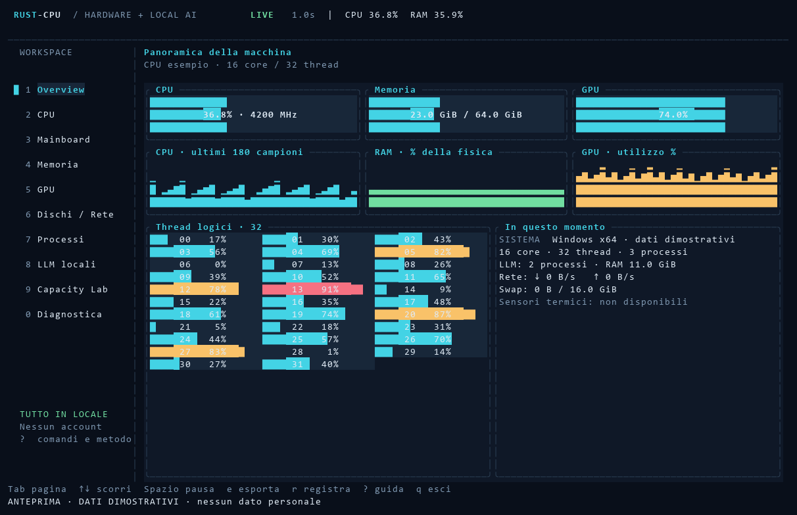

# RUST-CPU

**Hardware insight & Local AI Workbench** — una TUI Rust per conoscere il PC e seguire
le risorse durante l'esecuzione di LLM locali. Interfaccia italiana, tastiera e mouse,
temi scuro/chiaro, grafici, esportazione e registrazione. Prima piattaforma: Windows x64.

Software indipendente ispirato alla categoria degli strumenti di diagnostica hardware.
Non è un prodotto CPUID, non è affiliato a CPU-Z e non ne include codice o benchmark.



Anteprima con **dati dimostrativi**. Altre viste: [LLM](docs/screenshots/llm.png),
[processi](docs/screenshots/processi.png), [Capacity Lab](docs/screenshots/capacity.png).

## Installazione e avvio

Scarica l'installer o lo ZIP portable dalla pagina [Releases](https://github.com/danielegabrovec/rust-cpu/releases).
L'installer opera per l'utente corrente e aggiunge collegamenti al menu Start.
Non serve avviare come amministratore. Usa Windows Terminal con font Cascadia Mono/Consolas,
almeno 100×32 celle per la vista completa; sono gestiti anche terminali più piccoli.

```powershell
# Versione portable: nella cartella estratta
.\rust-cpu.exe

# Inventario e telemetria senza TUI
.\rust-cpu.exe --snapshot .\report.json

# Sessione di 60 campioni, uno al secondo, senza interrogare le LLM
.\rust-cpu.exe --record .\session.csv --samples 60 --interval-ms 1000 --no-llm

# Percorsi personalizzati, nessun file esistente viene sovrascritto
.\rust-cpu.exe --export-dir D:\Misure\RUST-CPU

# Aiuto completo
.\rust-cpu.exe --help
```

## Dieci viste

| Vista | Contenuto |
|---|---|
| Overview | CPU, memoria, GPU, grafici storici e processi principali |
| CPU | Identità, core/thread, cache CPUID, istruzioni e carico per core |
| Mainboard | Produttore, modello, BIOS, versione e data da WMI |
| Memoria | RAM, swap, moduli, capacità e velocità esposte da Windows |
| GPU | Inventario video, utilizzo, VRAM, temperatura e potenza NVIDIA quando disponibili |
| Dischi / Rete | Capacità, spazio disponibile, velocità I/O e traffico per interfaccia |
| Processi | PID, nome, CPU, RSS, I/O, ricerca, ordinamento e riconoscimento processi LLM |
| LLM locali | Stato runtime, modelli e residenza quando esposta; benchmark volontario |
| Capacity Lab | Stima esplicita di pesi e KV cache modificabile, confronto RAM/VRAM |
| Diagnostica | Provenienza, avvisi e limiti dei dati |

## Comandi

| Tasto | Azione |
|---|---|
| `Tab` / `Shift+Tab`, `←` / `→` | Vista successiva / precedente |
| `1`…`9`, `0` | Seleziona le dieci viste |
| `↑` / `↓`, `j` / `k`, `PgUp` / `PgDn`, `Home` / `End` | Selezione e scorrimento |
| `/` | Cerca nei processi; `Invio` / `Esc` termina la modifica |
| `s`, `a` | Cambia colonna di ordinamento, inverti direzione |
| `Invio` nei Processi | Dettaglio del processo selezionato |
| `Spazio` | Congela/riprende la vista; registrazione e raccolta continuano |
| `t` | Tema chiaro/scuro |
| `e` | Esporta snapshot JSON |
| `r` | Avvia/ferma registrazione CSV |
| `+` / `-` | Aumenta/riduce l'intervallo di campionamento (500–10000 ms) |
| `[` / `]`, `+` / `-` in Capacity Lab | Seleziona/modifica parametro |
| `F5` | Aggiorna runtime LLM |
| `b` nella vista LLM, poi `Invio` | Conferma benchmark del modello selezionato |
| `x` nella vista CPU, poi `Invio` | Benchmark CPU mix64 v1 singolo/multi thread |
| `c` durante un benchmark | Richiedi annullamento |
| `?` / `F1` | Guida |
| `q` / `Esc`, `Ctrl+C` | Esci (Esc prima chiude i pannelli aperti) |

La sidebar supporta il clic e la rotella scorre i contenuti. I report interattivi finiscono
in `%USERPROFILE%\Documents\RUST-CPU\exports`, modificabile con `--export-dir`.

## LLM locali

Le sonde interrogano esclusivamente endpoint HTTP loopback, senza proxy né redirect.
Impostazioni iniziali: Ollama `127.0.0.1:11434`, LM Studio `127.0.0.1:1234`,
llama.cpp `127.0.0.1:8080`. Modificabili con `--ollama-url`, `--lm-studio-url`,
`--llama-cpp-url`. Avvia il server del runtime prima del programma; i server assenti
restano indicati come offline e non bloccano il monitor hardware. `--no-llm` elimina le sonde.

Il monitoraggio non invia prompt. Il benchmark avviene solo su comando esplicito, invia
un prompt sintetico e richiede al massimo 64 token. Può caricare un modello e usare risorse:
non interrompe o misura automaticamente le conversazioni di altri programmi.
Le metriche di throughput dipendono da ciò che il server espone; `n/d` significa assente.
La responsabilità della configurazione locale/cloud del runtime resta al suo amministratore.

```powershell
# Benchmark esplicito: usa un modello già disponibile nel runtime
.\rust-cpu.exe --benchmark-runtime ollama --benchmark-model MODELLO_INSTALLATO
```

## Compilazione e qualità

Serve Rust stable **1.95 o superiore** e, su Windows, i Build Tools MSVC con Windows SDK.
Le dipendenze sono bloccate in Cargo.lock. Non servono Node, servizi cloud o Vercel.

```powershell
cargo build --release --locked
.\target\release\rust-cpu.exe
cargo fmt --all -- --check
cargo clippy --all-targets --locked -- -D warnings
cargo test --all-targets --locked
.\scripts\verify.ps1 -Release

# Installer: richiede NSIS 3.x e PowerShell 7
.\scripts\package.ps1
.\scripts\test-installer.ps1
```

La CI esegue build, test, Clippy e formattazione su Windows e Linux. Linux dispone della
telemetria sysinfo e CPUID su x86; WMI e l'installer restano specifici per Windows.
La verifica manuale su hardware Windows è descritta in [VERIFICHE](docs/VERIFICHE.md).

## Precisione e privacy

La frequenza esposta dal sistema non è una misura del clock istantaneo di ogni core.
Temperature, tensioni, timing SPD e sensori AMD/Intel non sono garantiti senza driver specifici.
GPU non NVIDIA: inventario disponibile, telemetria dinamica eventualmente assente.
Non vengono inventati valori, stimati token da caratteri o sommati RAM e VRAM come memoria unica.
L'uso CPU dei processi è normalizzato all'intera macchina. La somma RSS può contare pagine condivise.

Nessuna telemetria esterna. Le esportazioni includono nomi processi, PID, modelli e mount dei dischi,
ma non righe di comando, utenti, hostname, seriali hardware o MAC. Possono comunque rivelare attività:
rivedile prima di condividerle. I report e i binari generati sono esclusi da Git.

Approfondimenti: [manuale](docs/MANUALE.md), [architettura](docs/ARCHITETTURA.md),
[fonti e misure](docs/FONTI.md), [progetto](docs/PROGETTO.md), [build e release](docs/BUILD.md), [contributi](CONTRIBUTING.md).

Licenza [MIT](LICENSE). Autore: **Daniele Gabrovec**.
