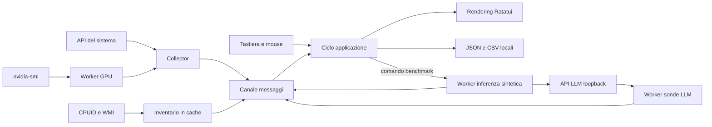

# Architettura, misure e confini operativi

RUST-CPU è un'applicazione Rust per terminale che unisce inventario hardware, campionamento delle risorse e osservabilità dei runtime LLM locali. L'eseguibile funziona come TUI oppure tramite comandi per snapshot, CSV, rendering testuale e benchmark. La scelta di una TUI mantiene l'applicazione utilizzabile anche senza browser o servizi di hosting.

## Struttura del sorgente

| File | Responsabilità |
| --- | --- |
| `src/main.rs` | Parsing CLI, convalida delle opzioni, avvio della TUI o delle operazioni senza terminale interattivo. |
| `src/model.rs` | Contratti dei dati, stato UI, ordinamento/filtro processi, storico e formule del Capacity Lab. |
| `src/collector.rs` | Inventario CPUID/WMI, campioni sysinfo, delta I/O e provider NVIDIA. |
| `src/bench.rs` | Microbenchmark CPU mix64 v1, fasi limitate e annullamento cooperativo. |
| `src/llm.rs` | Convalida delle origini locali, scoperta dei runtime, parsing NDJSON/SSE e benchmark espliciti. |
| `src/bench.rs` | Microbenchmark CPU intero, esplicito, con fasi singolo/multi thread e annullamento cooperativo. |
| `src/app.rs` | Ciclo eventi, worker, messaggi, navigazione, pausa, esportazione e avvio delle operazioni. |
| `src/ui.rs` | Layout Ratatui, tabelle, grafici, modali, temi e adattamento alle dimensioni del terminale. |
| `src/export.rs` | Report JSON con versione di schema e registrazione CSV. |
| `src/lib.rs` | Moduli pubblici condivisi dal binario e dai test. |



La UI riceve strutture di dati e non esegue le query hardware durante il disegno. Inventario, campionamento, sonde LLM e benchmark hanno compiti separati. La scrittura dei report resta un'operazione locale esplicita; errori di scrittura vengono riportati nella barra di stato.

## Campionamento e disponibilità delle misure

L'inventario relativamente stabile è memorizzato con `OnceLock`. Su Windows le query WMI vengono svolte in un thread dedicato; il chiamante attende al massimo quattro secondi e accetta un inventario parziale se il provider non risponde. Questo limite non termina forzatamente una query WMI già avviata.

Il raccoglitore mantiene le istanze `System`, `Disks`, `Networks` e `Components`. CPU e I/O richiedono almeno due osservazioni: il primo campione serve a stabilire la base. Le velocità vengono calcolate dai contatori cumulativi e dal tempo realmente trascorso, non soltanto dall'intervallo richiesto. I reset dei contatori non generano valori negativi. Le chiavi dei processi includono PID e tempo di avvio per non confondere un PID riutilizzato con lo stesso processo.

La percentuale CPU dei processi è normalizzata sull'intera macchina: un thread che satura un processore logico su una macchina da 16 thread pesa circa 6,25%. Le frequenze esposte dal sistema possono essere nominali; le frequenze dichiarate da firmware e CPUID hanno etichette distinte dalle misure di carico.

Il provider NVIDIA esegue una query `nvidia-smi` ogni due secondi in un worker separato. Ogni processo ha un limite di 800 ms e l'output accettato è limitato a 64 KiB. Dopo un errore o quando il campione supera sei secondi i sensori correnti vengono svuotati. Le GPU AMD/Intel individuate tramite inventario restano disponibili come righe hardware, con metriche non fornite indicate n/d. Non sono implementate sonde ROCm o Intel equivalenti.

Lo storico contiene fino a 180 campioni. La durata rappresentata dipende dall'intervallo e dal costo della raccolta. La pausa congela la vista delle risorse; raccolta, sonde dei runtime e registrazione CSV proseguono. Il timestamp consente di riconoscere l'età del campione esportato.

## Scoperta dei runtime LLM

Le origini predefinite sono:

| Runtime | Origine |
| --- | --- |
| Ollama | `http://127.0.0.1:11434` |
| LM Studio | `http://127.0.0.1:1234` |
| llama.cpp | `http://127.0.0.1:8080` |

Le tre sonde vengono eseguite in parallelo. Ciascuna richiesta di scoperta ha un timeout totale di un secondo; alcune sonde usano due richieste successive. Nell'applicazione interattiva un nuovo ciclo parte dopo l'attesa prevista dal worker o su richiesta F5; F5 non sovrappone nuovi cicli allo stesso worker.

| Stato | Significato |
| --- | --- |
| `online` | Il protocollo richiesto ha risposto con dati validi. Non prova che ci sia inferenza in corso. |
| `offline` | Connessione non disponibile o timeout. Un timeout non prova che il processo del server sia assente. |
| `auth` | HTTP 401/403. Il programma non trasmette chiavi di autenticazione. |
| `loading` | HTTP 503: server presente ma non pronto. Può indicare caricamento o indisponibilità temporanea. |
| `error` | Errore HTTP diverso, trasporto o struttura di risposta non valida. |
| `invalid` | Origine rifiutata prima di effettuare una richiesta. |

Ollama combina l'elenco installato con quello caricato. Se l'elenco dei modelli caricati non è disponibile, tale informazione non viene inventata. LM Studio usa l'API nativa e ripiega su `/v1/models` soltanto se la rotta nativa risponde 404/405. L'API nativa considera i modelli LLM; embedding e decision models non diventano candidati per un benchmark di testo. Se un modello ha più istanze caricate viene rappresentata la prima. Il contesto LM Studio è quello dell'istanza selezionata, oppure il massimo dichiarato quando l'istanza manca.

Il nome di un processo è soltanto un indizio di appartenenza a un runtime LLM. Il programma non attribuisce CPU, RAM o traffico di tutta la macchina a una singola conversazione. Non intercetta prompt, non legge file dei pesi e non conta i token di sessioni avviate da applicazioni esterne.

## Benchmark esplicito

La scoperta non chiama rotte di generazione. Il benchmark parte soltanto dall'azione dedicata nella TUI oppure dal comando CLI esplicito e usa questo prompt fisso:

> Descrivi in italiano, in tre brevi frasi, come organizzare una scrivania ordinata.

L'output richiesto è limitato a 64 token. Temperatura zero, e seed 42 per Ollama, riducono alcune variazioni senza garantire una generazione deterministica tra hardware, versioni o runtime. Il programma non conserva il testo generato e non trasmette l'inventario hardware nel prompt.

Prima dell'inferenza Ollama viene verificata la presenza locale del modello nell'elenco installato con dimensione positiva. `remote_host`, `remote_model`, nomi contenenti `cloud`, modelli assenti o dati locali non verificabili bloccano il benchmark. Questa è una protezione contro instradamenti remoti noti; non è una sandbox per la configurazione del server.

Il TTFT è il tempo misurato dal client fino al primo frammento non vuoto di contenuto o ragionamento ricevuto. Include coda, caricamento, prefill e trasporto locale. I frammenti di stream non corrispondono necessariamente a singoli token.

Per Ollama la velocità di decode usa `eval_count / eval_duration`. La velocità di prefill usa `(prompt_eval_count - prompt_eval_cached_count) / prompt_eval_duration`. Le durate sono convertite da nanosecondi. Se il runtime omette il contatore di cache, la velocità prefill resta n/d perché dividere l'intero prompt per il solo tempo non in cache può gonfiare il risultato.

Quando llama.cpp fornisce `timings`, i contatori e i millisecondi nativi vengono usati per decode/prefill. Per gli altri stream compatibili OpenAI, in assenza di tempi nativi il rapporto è `usage.completion_tokens / wall_seconds`: una misura end-to-end, distinta dal decode. Senza contatori reali, token e velocità sono `null` nei report e n/d in UI. Nessuna stima deriva dalla lunghezza del testo.

Un confronto sensato richiede stesso modello, quantizzazione, contesto, offload, carico di fondo e stato della cache. La durata di un singolo microbenchmark non certifica qualità delle risposte, stabilità termica, throughput multiutente o un punteggio equivalente a quello di CPU-Z.

### Microbenchmark CPU separato

La scheda CPU consente di richiedere con `x`, seguito dalla conferma, il test intero `mix64 v1`; dalla CLI si usa `--cpu-benchmark`. Due fasi da circa 600 ms misurano prima un thread e poi un numero di worker limitato ai processori disponibili e comunque a 16. Un'operazione è un mix dipendente di somma, due moltiplicazioni wrapping e tre XOR/shift su `u64`. Il risultato è espresso in operazioni/s e descrive soltanto questo kernel.

Il tempo effettivo include sincronizzazione e completamento dei worker; la creazione dei thread è fuori dall'intervallo della singola fase. I worker controllano tempo e annullamento ogni 256 operazioni. Il test non misura FLOPS, inferenza, banda RAM o un punteggio compatibile con CPU-Z. Confrontare soltanto la stessa versione e lo stesso tipo di compilazione: una build debug può avere prestazioni molto diverse da una release.

## HTTP locale, limiti e annullamento

La convalida accetta soltanto un'origine HTTP, una porta valida e un indirizzo IP loopback oppure `localhost`. Credenziali, percorsi, query, frammenti, separatori ambigui e host remoti vengono rifiutati. `localhost` viene fissato a `127.0.0.1` per evitare risoluzioni DNS o hosts esterne; per un server che ascolta soltanto su IPv6 usare esplicitamente `http://[::1]:porta`.

Proxy di ambiente e redirect sono disabilitati. I metadati sono limitati a 2 MiB e 1024 modelli; gli stream a 1 MiB, con righe/eventi fino a 64 KiB. I dati devono essere JSON valido o rispettare la struttura NDJSON/SSE prevista. Codici HTTP e messaggi generici sono sufficienti per la diagnostica: i corpi d'errore del server non vengono copiati nella UI.

Per l'inferenza il timeout di connessione è un secondo, ogni lettura può attendere al massimo 30 secondi e l'operazione completa ha un limite di 120 secondi. Un flag atomico viene controllato ogni 50 ms anche mentre la richiesta HTTP è in attesa. Nella vista ordinaria `c` richiede l'annullamento del benchmark in corso; `q` esce dall'applicazione. L'annullamento abbandona la richiesta e chiude la connessione del client. **Non termina il processo del runtime e non garantisce che il server abbia già fermato il calcolo**: manca un riscontro di annullamento del server.

L'uscita dalla TUI imposta i flag di arresto dei worker e di annullamento del benchmark e ripristina il terminale. I worker non vengono terminati forzatamente con API di sistema. La modalità CLI usa gli stessi limiti HTTP; un'interruzione esterna del processo non equivale alla ricezione di una conferma di stop dal modello.

Un server su loopback può essere un proxy verso altre macchine o servizi. Le restrizioni proteggono le destinazioni HTTP del client RUST-CPU; l'operatore rimane responsabile dell'instradamento interno di LM Studio, llama.cpp o di configurazioni personalizzate.

## Capacity Lab

La stima separa pesi, cache KV e margini:

```text
pesi_byte = parametri_miliardi × 1e9 × bit_per_peso / 8
kv_byte = 2 × layer × contesto × teste_KV × dimensione_testa × 2
richiesti_byte = pesi_byte × 1,15 + kv_byte + 512 MiB
```

Il primo fattore 2 della cache rappresenta key e value; il secondo due byte per elemento FP16. Le teste KV permettono di modellare GQA. L'overhead del 15% e i 512 MiB sono ipotesi di pianificazione, non misure del runtime. Quantizzazione dei pesi e quantizzazione della cache sono concetti diversi: la cache qui rimane FP16.

RAM libera e VRAM libera vengono considerate come risorse separate. La stima non garantisce un caricamento: memory mapping, batch, numero di sequenze parallele, MoE, MLA, cache quantizzata, offload parziale, allocazioni del driver e architetture particolari possono cambiare sensibilmente il risultato.

## Dati locali ed esportazione

Non sono previsti account, telemetria remota, analytics, aggiornamenti automatici o upload dei report. Non vengono richiesti hostname, seriali hardware, MAC address, riga di comando dei processi o contenuti delle conversazioni. Il normale monitoraggio LLM effettua comunque le richieste HTTP loopback descritte sopra; `--no-llm` disattiva le sonde automatiche.

I report JSON includono versione dello schema, versione dell'app, data UTC, inventario, ultimo campione, stato LLM ed eventuale benchmark CPU. Possono contenere nomi dei processi, PID, nomi di dischi/interfacce e identificativi di modelli; l'utente deve considerarli prima di condividere un report. Il CSV conserva contatori aggregati e valori GPU opzionali, senza inventare zeri per i sensori assenti. La somma RSS LLM resta indicata come somma, non memoria privata esclusiva.

Le esportazioni usano creazione esclusiva del file: un percorso esistente non viene sovrascritto. Il CSV viene scaricato sul file dopo ogni campione. L'export JSON completa la scrittura e sincronizza il file; in caso di errore tenta di rimuovere il file incompleto. La cartella di destinazione è modificabile con opzione CLI.

## Verifica ed estensione

Le verifiche hanno livelli distinti: test delle formule e del parser; richieste HTTP reali a server simulati su loopback; rendering Ratatui con backend di test; esecuzione locale sul sistema; prova di runtime e modello reali; installazione/disinstallazione dell'artefatto distribuito. Passare un livello non certifica automaticamente i successivi.

Un nuovo provider deve preservare il significato di `Option`: n/d quando il dato manca. Un nuovo runtime deve rispettare destinazioni locali, limiti dei corpi, timeout e annullamento; non introdurre inferenza dentro le sonde. Prima di cambiare il significato di un campo esportato, aggiornare la versione dello schema e la documentazione. Le fonti primarie e le differenze tra dati misurati e dichiarati sono raccolte in [FONTI.md](FONTI.md).
