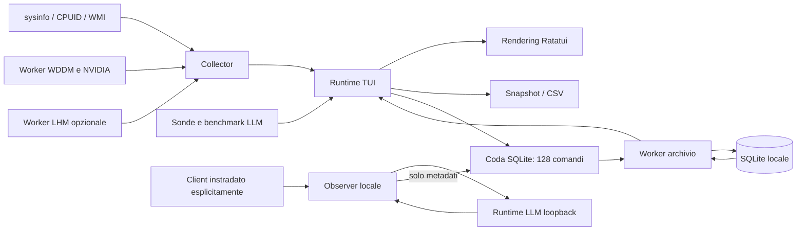

# Architettura 0.2, misure e persistenza

RUST-CPU unisce inventario hardware, telemetria delle risorse, osservazione LLM e
un archivio SQLite locale. La TUI e la CLI condividono contratti e provider.
Questa descrizione riguarda la versione 0.2; lo storico delle verifiche 0.1 resta
in [VERIFICHE.md](VERIFICHE.md).

## Moduli e flusso dei dati

Il sorgente è suddiviso in 16 file funzionali; `lib.rs` registra i moduli comuni
al binario e ai test.

| File | Responsabilità |
| --- | --- |
| `main.rs` | CLI, destinazioni, selezione delle operazioni, avvio TUI/observer e percorsi locali. |
| `app.rs` | Azioni da tastiera e mouse, navigazione e stato delle finestre modali. |
| `app_runtime.rs` | Ciclo TUI, messaggi dei worker, sessioni, replay, confronti, registrazioni ed esportazioni. |
| `ui.rs` | Rendering Ratatui, layout adattivo, temi, tabelle, grafici e dialoghi. |
| `model.rs` | Inventario, campioni, processi, GPU, risultati LLM, storico e Capacity Lab. |
| `collector.rs` | Coordinamento dei provider, inventario in cache, sysinfo e delta dei contatori. |
| `gpu_windows.rs` | GPU Windows tramite DXGI e contatori WDDM/PDH, anche per PID. |
| `sensors.rs` | Lettura opzionale dei sensori WMI LibreHardwareMonitor già disponibili. |
| `llm.rs` | Scoperta runtime, autenticazione upstream, parser NDJSON/SSE e benchmark espliciti. |
| `observer.rs` | Proxy loopback esplicito, inoltro del traffico e osservazioni di soli metadati. |
| `bench.rs` | Microbenchmark CPU mix64 v1 con durata e numero di thread limitati. |
| `export.rs` | Snapshot JSON, CSV e rendering vettoriale del buffer terminale. |
| `storage.rs` | Schema SQLite, transazioni, import/export, backup, statistiche e confronti. |
| `workspace_runtime.rs` | Worker SQLite, coda limitata, risposte e chiusura verificata. |
| `workspace.rs` | Stato UI di archivio, replay, selezioni dei confronti e cronologia. |
| `settings.rs` | Preferenze validate, soglie, cooldown e avvisi. |

Il rendering riceve dati già raccolti e non esegue query hardware o SQLite nel
metodo di disegno. I provider hardware, HTTP e archivio hanno compiti distinti.
La pausa congela la vista delle risorse; raccolta e registrazioni continuano.
Replay e confronto usano dati caricati dall'archivio, senza sostituirli con la
telemetria live. Il dettaglio processo conserva il PID selezionato.

## Hardware e provenienza

L'inventario stabile usa `OnceLock`. CPUID descrive identificazione e capacità
hardware; WMI aggiunge scheda madre, BIOS e DIMM tramite un worker con attesa
iniziale massima di quattro secondi. Un provider bloccato non viene terminato
forzatamente. Clock e tensioni dichiarati dal firmware restano distinti dalle
letture correnti.

Il collector conserva le istanze sysinfo e calcola le velocità I/O su differenze
di contatori e tempo effettivo trascorso. I reset non producono rate negativi;
PID e tempo di avvio distinguono processi diversi che riusano lo stesso numero.
La CPU di un processo è normalizzata sull'intera capacità logica dell'host.
Lo storico grafico live contiene al massimo 180 campioni.

Su Windows DXGI associa gli adattatori ai contatori WDDM tramite LUID interni,
mai aggiunti ai report. PDH usa nomi inglesi indipendenti dalla lingua Windows.
Il carico dell'adattatore è il suo motore più occupato; la memoria dedicata e
quella condivisa rimangono separate. Le attribuzioni per PID non devono essere
sommate per ricostruire il consumo fisico: risorse condivise possono apparire
in più processi.

Il worker WDDM campiona normalmente ogni secondo e scarta letture oltre cinque
secondi. NVIDIA può integrare temperatura e potenza tramite `nvidia-smi`, ogni
due secondi, con limite di 800 ms per comando e scadenza dei campioni a sei
secondi. L'associazione per nome è accettata solo quando esatta e univoca.
`GpuRow.source` conserva la provenienza del carico, compreso un eventuale fallback.

Il provider LHM legge soltanto un namespace `ROOT\LibreHardwareMonitor` già
attivo. Temperature e tensioni live hanno prefisso di fonte e unità distinte;
i valori più vecchi di quattro secondi sono esclusi. I worker WDDM e LHM sono
condivisi nel processo e sospendono nuove query quando non hanno collector
iscritti. Nessun driver, servizio o programma esterno viene installato o avviato.

Nelle prove 0.2 sul PC di sviluppo sono stati osservati dati WDDM reali sia
sull'adattatore AMD sia su quello NVIDIA, compresi memoria condivisa e dati per
PID. LHM sullo stesso PC era assente: il percorso di conversione è verificato
con dati controllati, senza dichiarare temperature CPU reali non misurate.
Per unità, algoritmi e limiti SPD/timing consultare [HARDWARE.md](HARDWARE.md).

## SQLite: schema, scrittura e arresto

`rusqlite 0.40.2` usa SQLite bundled. L'archivio è riconosciuto con
`application_id = 0x52544350` (1381253968) e `user_version = 1`. Un database di
un'altra applicazione o di una versione futura viene rifiutato. I valori delle
query usano parametri associati; i nomi di colonna delle statistiche sono un
insieme interno fisso.

| Tabella | Contenuto |
| --- | --- |
| `sessions` | Nome, stato, tempi, intervallo, versione originale dell'app e inventario JSON. |
| `samples` | Metriche indicizzabili e payload JSON del campione associato alla sessione. |
| `benchmarks` | Risultati CPU, sintetici LLM e osservati, con associazione sessione facoltativa. |
| `preferences` | Preferenze UI validate, salvate con chiave stabile. |
| `alerts` | Eventi di soglia e associazione sessione facoltativa. |

Le relazioni usano chiavi esterne e cancellazione in cascata. La connessione
abilita `foreign_keys`, modalità **WAL** e `synchronous = FULL`; il normale busy
timeout è due secondi. WAL permette a observer e TUI di usare connessioni diverse
allo stesso archivio locale. Non è una soluzione per condividere il database
tra computer tramite un filesystem di rete.

Il worker archivio possiede la connessione e riceve al massimo **128 comandi**
in coda. Una coda piena restituisce un errore. Avvio sessione e primo campione
valido formano una transazione unica: un primo campione errato non lascia una
sessione aperta nascosta. Un errore di registrazione ferma quella registrazione
e tenta di conservarne lo stato `incomplete`; un errore di consultazione o export
non ferma automaticamente una registrazione sana.

La chiusura ha un unico budget di **cinque secondi**, comprensivo dell'inserimento
del comando di stop e dell'attesa della conferma. Non esiste un invio bloccante
illimitato davanti al timeout. La conferma arriva dopo la chiusura della sessione
e il rilascio dello store; un errore di chiusura viene propagato. Se il budget
scade, i dati già committati restano nell'archivio e il programma non dichiara
confermati i comandi ancora in attesa.

Il backup usa l'API SQLite online, passi da 128 pagine, deadline di cinque secondi
e retry di dieci millisecondi per `Busy`/`Locked`. Un nome esistente non viene
sovrascritto. Un fallimento tenta di rimuovere il file incompleto e segnala anche
l'eventuale errore di rimozione. Non si copia semplicemente il file principale di
un database WAL ancora aperto.

L'import JSON ammette snapshot schema 1 e sessioni formato 1, fino a **64 MiB,
50.000 campioni e 10.000 benchmark/avvisi**. Il contenuto viene importato in una
transazione; tipo e payload del benchmark devono corrispondere. La versione di
origine viene conservata; nei file vecchi che non la contengono resta ignota.
Un export JSON di una sessione molto lunga può superare questi limiti di import:
il backup SQLite resta il formato per conservare l'intero archivio. Non viene
sostituito automaticamente un database esistente durante un'importazione.

## Statistiche, replay e confronti

Le statistiche SQL considerano **tutti i campioni salvati**, escludendo i valori
mancanti. Uno zero valido resta incluso. La media è la media aritmetica dei
campioni, non una media pesata per tempo. Il P95 usa il rango più vicino:
`ceil(0,95 × N)` nella serie ordinata dei valori presenti. Durata campionata è
la differenza tra elapsed massimo e minimo; un solo campione ha durata zero.

Il replay caricato dalla TUI contiene al massimo 2.000 punti distribuiti lungo
la sessione. I confronti usano al massimo 400 punti per lato. Quando esistono
almeno due punti, primo e ultimo sono preservati. La riduzione riguarda i grafici,
non le statistiche dell'intera sessione. I grafici del confronto normalizzano
l'avanzamento: non implicano che i lavori abbiano identica durata.

Il confronto visualizzato è un oggetto conservato in memoria. La TUI esporta
`ExportFrozenComparison` con una copia di quell'oggetto: nuovi campioni o una
chiusura successiva della sessione non cambiano il JSON rispetto a ciò che era
visibile. Un confronto richiesto nuovamente dalla CLI o dal database è invece
una nuova lettura.

Differenze assolute e percentuali hanno ruoli distinti; una base zero produce
percentuale n/d. I riepiloghi GPU si riferiscono a GPU0: ordine, fonte sconosciuta,
provider differenti e versioni dell'app differenti generano avvisi. Minore carico
non dimostra da solo che lo stesso lavoro sia stato svolto più velocemente.

I benchmark sono raggruppati per provenienza: CPU per algoritmo, worker e tipo di
build; LLM per tipo sintetico/osservato, runtime, modello e metodo di throughput.
Decode nativo, end-to-end e metodo ignoto non diventano una sola velocità. Le
osservazioni esterne rimangono separate. Stesso gruppo non prova equivalenza di
quantizzazione, contesto, offload, prompt, cache o stato termico.

## Runtime LLM, autenticazione e observer

Le sonde automatiche interrogano solo metadati di Ollama, LM Studio e llama.cpp;
non generano testo né scaricano modelli. Il benchmark sintetico richiede un'azione
esplicita e usa un prompt fisso con massimo 64 token di output. Il microbenchmark
CPU separato esegue due fasi da circa 600 ms, fino a 16 worker: misura mix64 v1,
non un punteggio CPU-Z né la velocità di un modello.

L'observer è un proxy avviato esplicitamente su `127.0.0.1`. Osserva solo richieste
che il client invia a quella porta; non intercetta altro traffico. Inoltra byte
al runtime e raccoglie modello, contatori e tempi. **Prompt, risposte, ragionamenti,
cookie e token non vengono mai persistiti**, né passati al callback dei risultati.
I byte necessari al parsing esistono soltanto durante l'inoltro.

L'upstream è una sola origine HTTP loopback validata, senza proxy di ambiente o
redirect. Le credenziali upstream vengono lette dalle variabili
`RUST_CPU_OLLAMA_TOKEN`, `RUST_CPU_LM_STUDIO_TOKEN` e `RUST_CPU_LLAMA_CPP_TOKEN`.
Non vengono inserite negli URL, nei DTO esportati o nel database.

`RUST_CPU_OBSERVER_TOKEN` protegge l'ingresso del proxy con Bearer. Quando è
configurata una chiave upstream, il token frontend è obbligatorio e l'avvio senza
quest'ultimo viene rifiutato. Le credenziali inviate dal client non sono inoltrate
come credenziali upstream. La configurazione e i comandi sono in
[OBSERVER.md](OBSERVER.md).

L'observer ammette quattro richieste attive, con richiesta fino a 1 MiB, risposta
fino a 16 MiB e metadati fino a 2 MiB. Usa timeout di connessione di un secondo,
lettura di 30 secondi e durata totale di 120 secondi. Invia allo store solo
osservazioni concluse valide tramite la coda del worker. Un'associazione esplicita
viene ricontrollata al salvataggio: una sessione già chiusa produce un risultato
standalone con nota. Annullare il trasporto non certifica che il runtime abbia
fermato immediatamente il proprio calcolo.

Le velocità usano contatori reali: tempi nativi quando disponibili, altrimenti
output token dichiarati divisi per il tempo end-to-end. TTFT richiede uno stream
con primo contenuto/ragionamento non vuoto; una risposta JSON non streaming non
fornisce un TTFT misurabile. Nessuna stima usa il numero di caratteri.

## Verifiche e confini

Le verifiche HTTP 0.2 comprendono **32 casi locali: 20 nel client LLM e 12
nell'observer**, inclusi autenticazione, limiti e stream. Sono prove con server
controllati; non certificano ogni runtime reale. Le prove TUI sul PC di sviluppo
comprendono sessione SQLite, confronto, replay, rinomina e backup. Comandi,
artefatti ed esiti definitivi della release sono riportati in
[VERIFICHE.md](VERIFICHE.md), separati dalla documentazione delle API.

L'archivio conserva metadati e, per i campioni, le sole righe processo marcate
LLM dall'euristica sul nome: non prova l'attribuzione a una conversazione.
La vista processi live rimane completa. Snapshot espliciti possono
includere nomi e PID di altri processi. Non vengono letti hostname, seriali,
indirizzi MAC o righe di comando. Le fonti primarie e il significato delle misure
sono elencati in [FONTI.md](FONTI.md); i limiti hardware fondamentali restano in
[HARDWARE.md](HARDWARE.md).
