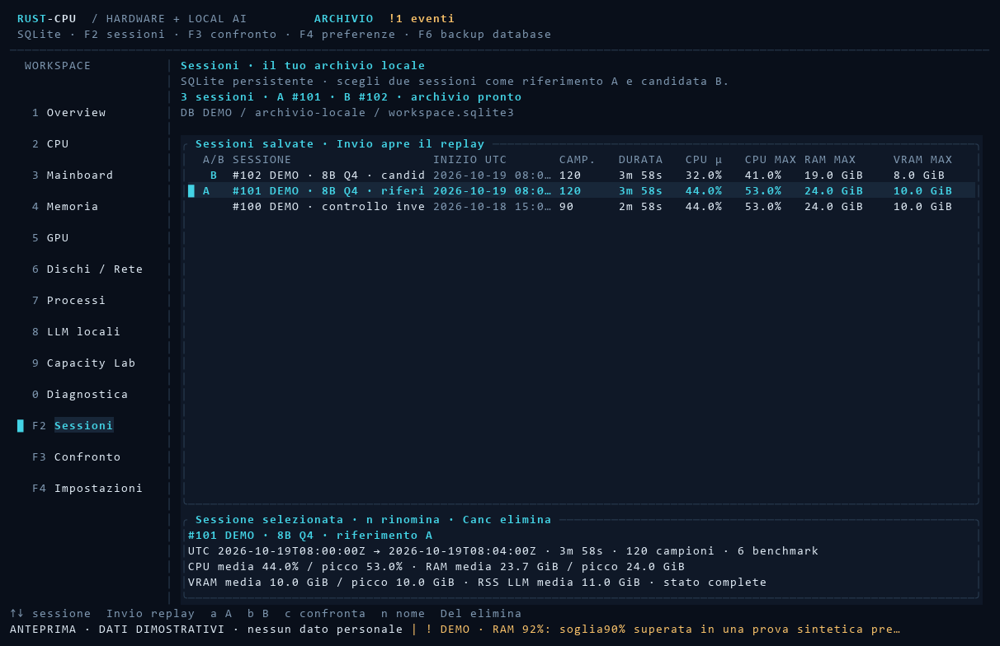
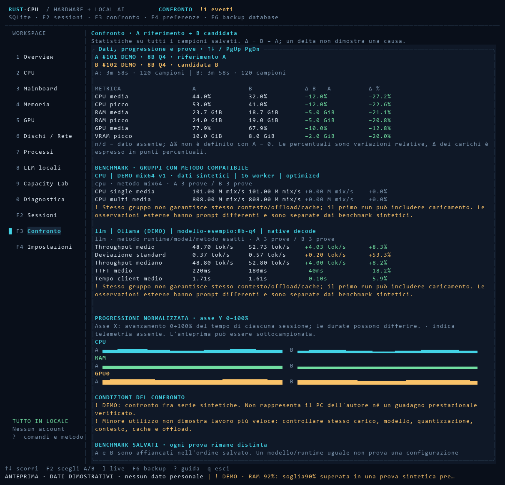
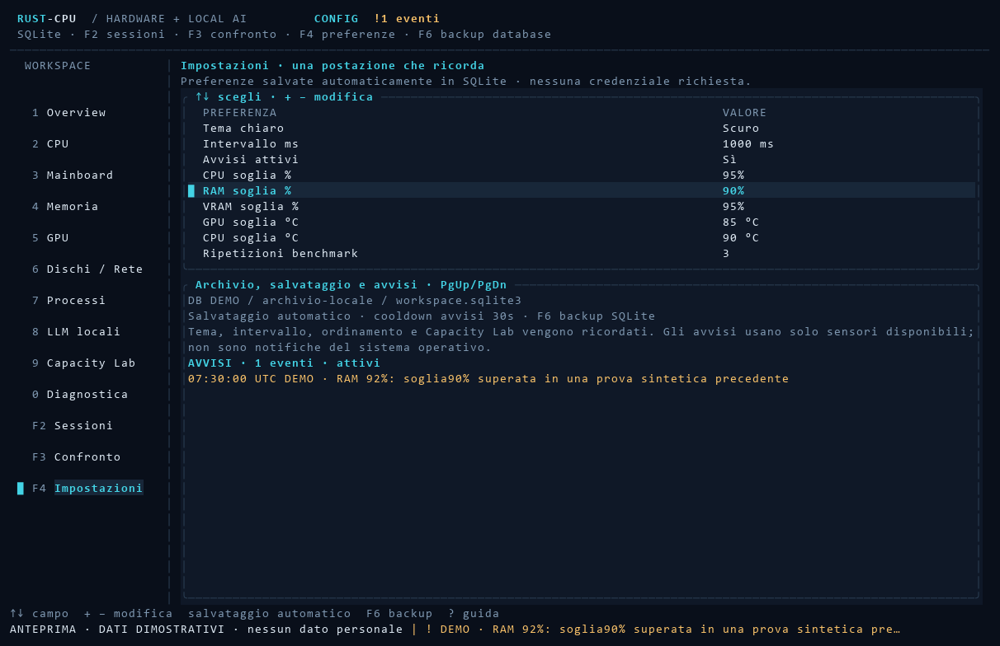

# Sessioni, replay e confronti

RUST-CPU 0.2 conserva misure, benchmark, avvisi e preferenze in un archivio SQLite
locale. Una sessione raccoglie un lavoro identificabile: per esempio una generazione
con un modello, una prova CPU o un periodo di osservazione delle risorse.

L'archivio permette di tornare sui dati e affiancare due prove. Non certifica da solo
che il lavoro svolto, il contesto del modello o le condizioni del computer fossero uguali.

Le immagini di questa pagina contengono **solo dati dimostrativi generati dal codice
dell'esempio**. Non rappresentano misure del PC dell'autore, conversazioni o risultati
prestazionali reali. Il generatore non legge un database personale e non esegue inferenza.



## Dove vengono salvati i dati

Su Windows il database predefinito è:

```text
%LOCALAPPDATA%\RUST-CPU\workspace.sqlite3
```

La variabile d'ambiente `RUST_CPU_DATABASE` può scegliere un'altra posizione;
`--database FILE`, abbreviabile in `--db FILE`, ha precedenza. Usare lo stesso file
per la TUI, i comandi CLI e l'eventuale proxy permette di lavorare sul medesimo archivio.

Il database contiene:

- Identità e versione dell'applicazione, nome, date UTC e stato di ciascuna sessione.
- Inventario acquisito all'avvio della sessione e campioni delle risorse.
- Benchmark CPU, benchmark LLM volontari e osservazioni provenienti dal proxy,
  mantenuti come tipi distinti.
- Avvisi e preferenze persistenti.

Nei campioni archiviati la lista dei processi conserva quelli riconosciuti come LLM.
La vista live **Processi** mostra invece tutti i processi accessibili: il replay non è
una registrazione completa del Task Manager. Il riconoscimento LLM rimane euristico,
basato sul nome; non dimostra quale modello o conversazione usasse un processo.

Le letture hardware non disponibili restano assenti. `n/d` non viene convertito in
una misura pari a zero. L'inventario, i nomi dei modelli e i nomi dei processi salvati
possono comunque essere informazioni personali da controllare prima della condivisione.

## Registrare un lavoro nella TUI

1. Attendere il primo campione valido e l'inventario iniziale.
2. Premere `r`: viene avviata una sessione SQLite e viene tentata anche la registrazione CSV.
3. Eseguire il proprio lavoro nel runtime LLM o nell'applicazione da osservare.
4. Premere di nuovo `r`: la sessione viene chiusa e rimane disponibile nell'archivio.
5. Premere `F2`, scegliere la sessione e usare `n` per assegnarle un nome utile.

Se la creazione del CSV fallisce, un messaggio distingue il problema dalla registrazione
SQLite. Controllare la barra di stato: l'avvio di una richiesta di salvataggio e la sua
conferma sono momenti distinti. Le operazioni sul database avvengono in un worker separato.

`Spazio` congela la vista hardware, mentre raccolta e registrazione continuano. Anche
durante un replay una registrazione live già attiva continua a registrare i campioni
del computer, non quelli che si stanno rileggendo.

Un benchmark volontario avviato senza una registrazione attiva crea una sessione
automatica per conservare risorse e risultati. Se una sessione è già in registrazione,
il risultato viene associato a quella sessione. Le richieste osservate dal proxy possono
invece essere salvate senza sessione: la cronologia LLM le identifica esplicitamente.

## Comandi dell'archivio

| Comando | Effetto |
|---|---|
| `F2` | Apre e aggiorna l'elenco delle sessioni. |
| `↑` / `↓`, `PgUp` / `PgDn`, `Home` / `End` | Selezionano una sessione nell'elenco. |
| `Invio` | Carica il replay della sessione selezionata. |
| `a` nell'archivio | Imposta la sessione come riferimento **A**. |
| `b` nell'archivio | Imposta la sessione come candidata **B**. |
| `c` nell'archivio o nel confronto | Carica il confronto fra A e B. |
| `F3` | Apre il confronto; occorre aver scelto A e B. |
| `n`, poi `Invio` | Rinomina la sessione selezionata. `Esc` annulla. |
| `Canc` / `Delete`, poi `Invio` | Elimina la sessione dopo la conferma. `Esc` annulla. |
| `e` nella vista Sessioni | Esporta la sessione selezionata in JSON. |
| `e` nella vista Confronto | Esporta un confronto delle due sessioni in JSON. |
| `F6` | Richiede un backup del database. |

I nomi ammettono da 1 a 120 caratteri visibili. Eliminare una sessione rimuove i suoi
campioni e gli eventi associati; non è previsto un cestino. La sessione attualmente
in registrazione non può essere eliminata. Un'esportazione o un backup permettono di
conservare una copia prima di rimuoverla.

## Rileggere una sessione

Il badge **REPLAY** identifica i dati caricati. L'intestazione indica l'ID della
sessione e la posizione del campione visualizzato. Con `[` e `]` si passa al campione
precedente o successivo; `l` torna al monitor live. Nella pagina Capacity Lab gli stessi
tasti continuano a scegliere il parametro della stima: cambiare pagina per scorrere il replay.

Le pagine hardware usano l'inventario salvato e il campione scelto. I dati delle API dei
runtime non vengono inventati: in replay non si ricostruisce l'elenco live dei modelli
che il server avrebbe restituito in quel momento. I benchmark associati e le osservazioni
salvate rimangono consultabili. Un benchmark salvato appartiene alla sessione, non
necessariamente all'istante del campione visualizzato.

La cronologia nella pagina LLM comprende anche le ultime 100 prove o osservazioni del
database, con tipo, data e associazione alla sessione. Non è l'elenco delle generazioni
attualmente in corso. `PgUp` e `PgDn` scorrono i risultati; `↑` e `↓` selezionano il modello
nell'elenco live. I benchmark nuovi richiedono il ritorno alla vista live con `l`.

Il replay carica un'anteprima di **massimo 2.000 campioni**, distribuiti sull'intera
sessione e comprendenti il primo e l'ultimo quando presenti. Per una sessione lunga,
un passo del replay può quindi saltare campioni intermedi. Il contatore distingue i
campioni caricati dal totale salvato. Lo storico della Overview conserva al massimo
180 campioni visualizzati: non equivale automaticamente a 180 secondi.

Un archivio aperto o incompleto resta consultabile, ma non certifica una registrazione
terminata correttamente. Una sessione senza campioni non acquista valori sintetici.

## Affiancare A e B



In `F2` scegliere una sessione e premere `a`; scegliere la seconda e premere `b`.
Premere `c` oppure `F3`. Il verso è sempre **B meno A**. Non è possibile confrontare
una sessione con se stessa. Scorrere il confronto per leggere statistiche, gruppi di
benchmark, grafici, avvisi e provenienza delle singole prove.

Le statistiche delle risorse usano **tutti i campioni salvati**, non solo l'anteprima
dei grafici. Ogni campo considera solo i campioni nei quali quel dato è disponibile:

```text
media = somma dei valori disponibili / numero di valori disponibili
picco = massimo dei valori disponibili
P95 = valore ordinato in posizione ceil(0,95 × n), contando da 1
durata campionata = ultimo elapsed_secs − primo elapsed_secs
delta = B − A
delta percentuale = 100 × (B − A) / abs(A), quando A è diverso da zero
```

Con A uguale a zero, oppure con un dato mancante, la variazione relativa è `n/d`;
non viene mostrato un incremento infinito. Per un carico CPU dal 40% al 50%, il delta
è **10 punti percentuali**, mentre la variazione relativa è **25%**.

La media è aritmetica sui campioni, **non pesata per il tempo**. Cambiare intervallo
durante una prova, lasciare pause nella raccolta o confrontare durate molto diverse
richiede cautela. Un solo campione produce durata campionata zero. RAM e VRAM sono
espresse in byte con visualizzazione binaria KiB/MiB/GiB; i carichi sono percentuali.

I grafici di confronto usano al massimo 400 campioni per sessione e ne normalizzano
l'avanzamento nel tempo da 0 a 100%. Le due estremità rappresentano inizio e fine di
ogni prova, anche se le durate sono diverse. L'asse verticale dei carichi è 0–100%;
il simbolo `·` indica assenza di telemetria. L'interpolazione dell'anteprima non
ricostruisce picchi persi fra i punti visualizzati; il picco numerico proviene invece
dal riepilogo completo salvato.

Gli avvisi segnalano, fra l'altro, differenze di CPU, RAM, GPU, ordine degli adattatori,
provider delle misure, versione dell'app o sessioni non completate. GPU0 identifica il
primo adattatore della rilevazione: non è una somma di tutte le schede video. Una RAM
inferiore o un carico CPU più basso non dimostrano automaticamente prestazioni migliori.

## Confrontare i benchmark

Le prove vengono raggruppate prima di calcolare le statistiche:

- **CPU:** stesso kernel, numero di worker e profilo di compilazione.
- **LLM:** stesso tipo di prova, runtime, identificativo del modello e metodo del throughput.
- **Osservazioni del proxy:** gruppo distinto dai benchmark volontari, anche se il modello coincide.

Per le LLM vengono mostrati throughput medio e mediano, deviazione standard, TTFT
medio e durata media misurata dal client. La deviazione standard usa il divisore `n`:
descrive il gruppo salvato, non un intervallo di confidenza. Una sola prova può avere
deviazione zero senza dimostrare stabilità. Il numero di prove A/B è sempre importante.

`native_decode` usa il tempo di generazione esposto dal runtime. `end_to_end` usa la
durata complessiva misurata dal client e può comprendere caricamento, prefill e coda.
Questi metodi non misurano la stessa cosa. I dati importati più vecchi possono avere
metodo o build sconosciuti: il programma li segnala, senza certificarne l'equivalenza.

Un gruppo compatibile non garantisce stesso contesto, quantizzazione, cache, offload,
prompt o carico di fondo. Il primo tentativo può includere il caricamento del modello.
Le richieste osservate attraverso il proxy possono avere prompt e lunghezze diverse;
non diventano per questo un benchmark controllato. Le note delle singole prove restano
leggibili nel confronto.

Nella TUI `b` avvia una prova LLM e `x` una prova CPU, con conferma. `Shift+B` e
`Shift+X` richiedono una serie secondo il numero impostato in `F4` (da 1 a 10;
predefinito 3). Ogni inferenza richiede al massimo 64 token di output. Ogni prova CPU
genera circa 1,2 secondi di carico: quattro ripetizioni richiedono circa 4,8 secondi,
oltre ai costi di coordinamento. `c` richiede l'annullamento. La cancellazione di una
richiesta LLM non certifica che il server abbia già fermato il calcolo.

## Preferenze e avvisi



`F4` apre nove campi: tema, intervallo, attivazione avvisi, soglie CPU/RAM/VRAM,
temperature GPU/CPU e numero di ripetizioni. `↑` e `↓` scelgono il campo; `+` e `-`
lo modificano. `PgUp` e `PgDn` scorrono la parte con database, informazioni e avvisi.

Le preferenze sono salvate automaticamente nell'archivio. Vengono ricordati anche
ordinamento e direzione della tabella processi e parametri del Capacity Lab. Gli URL
locali dei runtime sono configurabili con le opzioni CLI e vengono conservati nello
stesso database. Un'opzione esplicita `--interval-ms` o `--…-url` aggiorna quindi
anche la preferenza salvata: non è soltanto una modifica temporanea del rendering.

Gli avvisi vengono generati al raggiungimento della soglia, con un cooldown per tipo
di sensore (predefinito 30 secondi). Sono eventi locali nell'applicazione, non notifiche
del sistema operativo. Disabilitarli sospende i nuovi eventi e conserva quelli già
salvati. Un sensore assente non genera un falso valore sotto soglia. Le temperature CPU
richiedono un provider che le esponga realmente: la presenza di un campo nelle impostazioni
non aggiunge un sensore al computer.

Per ripristinare le preferenze senza cancellare le sessioni:

```powershell
.\rust-cpu.exe --database .\archivio.sqlite3 --reset-settings
```

## Esempi CLI

Aprire PowerShell nella cartella portable che contiene `rust-cpu.exe`, oppure sostituire
il percorso dell'eseguibile. Gli ID `1` e `2` sono esempi: usare quelli restituiti dal
proprio elenco. I nomi dei file di output devono essere nuovi.

```powershell
# Registra risorse per 60 campioni; non interroga le API dei runtime.
.\rust-cpu.exe --database .\archivio.sqlite3 --save-session "baseline-8B-Q4" --samples 60 --interval-ms 1000 --no-llm

# Legge gli ID, i nomi e i riepiloghi salvati.
.\rust-cpu.exe --database .\archivio.sqlite3 --sessions

# Produce un confronto JSON e una vista SVG dell'archivio, senza campionare il PC.
.\rust-cpu.exe --database .\archivio.sqlite3 --compare 1 2 --comparison-output .\confronto-1-2.json --render .\confronto-1-2.svg

# Esporta tutti i campioni della sessione; il limite del replay non taglia l'export.
.\rust-cpu.exe --database .\archivio.sqlite3 --load-session 1 --export-session .\sessione-1.json

# Renderizza un campione dell'anteprima sulla prima pagina hardware.
.\rust-cpu.exe --database .\archivio.sqlite3 --load-session 1 --sample-index 10 --tab 1 --render .\replay-1.svg

# Importa una sessione in un altro archivio, assegnandole un nuovo ID locale.
.\rust-cpu.exe --database .\altro-archivio.sqlite3 --import-session .\sessione-1.json

# Cambia il nome e crea un backup senza sovrascrivere file precedenti.
.\rust-cpu.exe --database .\archivio.sqlite3 --rename-session 1 --session-name "8B Q4 · prova di riferimento"
.\rust-cpu.exe --database .\archivio.sqlite3 --backup-db .\backup-archivio.sqlite3
.\rust-cpu.exe --database .\archivio.sqlite3 --db-check
```

`--sample-index` conta da zero nell'anteprima, non nella sequenza completa salvata.
Un indice oltre il limite visualizza l'ultimo campione disponibile. Le operazioni
archivio non si combinano nello stesso comando con una nuova registrazione o un
benchmark: eseguire comandi separati, come negli esempi.

## Backup, esportazione e recupero

`F6` crea un backup SQLite nella cartella delle esportazioni e ne riporta il percorso
nella barra di stato. `--backup-db` permette una destinazione esplicita. Il programma
usa l'API di backup SQLite e segnala errori o indisponibilità; la richiesta non equivale
alla conferma di completamento. Il backup contiene anche preferenze ed eventi non
associati a una sessione. Per riprenderlo, avviare l'applicazione con `--database`
indicando il file di backup.

L'export di una sessione è JSON `format_version: 1`, con riepilogo, inventario,
campioni, benchmark e avvisi associati. Contiene tutti i campioni: non l'anteprima
ridotta della TUI. Benchmark e avvisi esportati sono limitati a 10.000 eventi per tipo.
L'import ammette file fino a 64 MiB, 50.000 campioni e 10.000 benchmark/avvisi; un export
molto grande può quindi essere consultabile come file senza essere reimportabile.
Un backup del database conserva l'intero archivio.

Il controllo `--db-check` verifica l'integrità SQLite; non dimostra che una registrazione
sia completa o che una misura hardware sia accurata. I test effettivamente eseguiti,
le prove sui runtime e le piattaforme non verificate sono descritti in
[VERIFICHE.md](VERIFICHE.md). Per osservare richieste di altre applicazioni instradate
consapevolmente attraverso il proxy, consultare [OBSERVER.md](OBSERVER.md).
